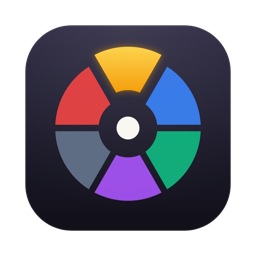
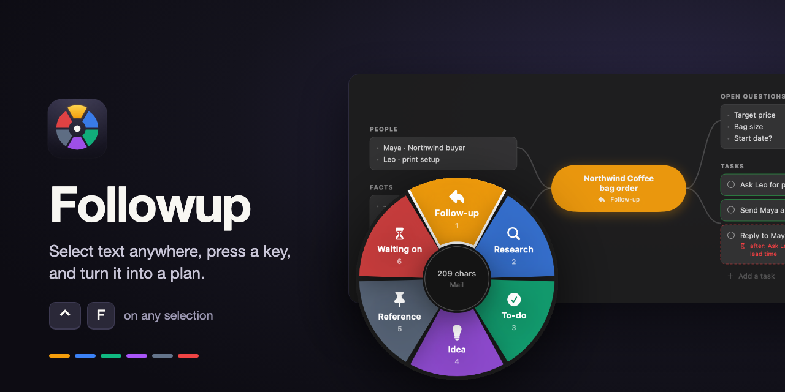
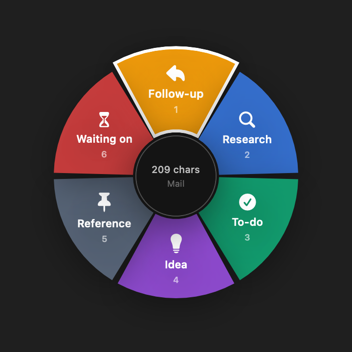
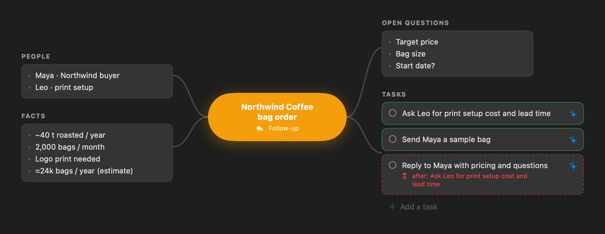
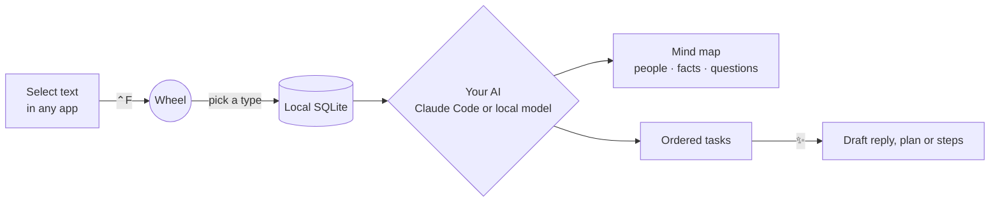

<div align="center">



# Followup

**Select text anywhere on your Mac, press <kbd>⌃</kbd> <kbd>F</kbd>, and turn it into a plan.**

A tiny menu-bar app that captures what you're reading, files it with a flick of a wheel,<br>
and uses AI to map it out and help you get it done.

[](https://github.com/harshf15-code/Followup/releases/latest)
[](#install)
[](Package.swift)
[](https://github.com/harshf15-code/Followup/actions/workflows/ci.yml)
[](LICENSE)

[**Download for Mac**](https://github.com/harshf15-code/Followup/releases/latest) · [One-line install](#install) · [How it works](#how-it-works) · [FAQ](#faq) · [Build from source](#build-from-source)



</div>

## Why Followup?

You're reading a chat, an email or a web page and spot something you'll need to deal with: a customer asking for a quote, a library worth trying, a promise someone made you. Copying it into a notes app breaks your flow, and the note just sits there.

Followup takes two seconds and does the next part for you. It works out who's involved, what the facts are, what's still unknown, and what to do first. When you're ready, it drafts the reply.

## Features

<table>
<tr>
<td width="50%" valign="top">

### 🎯 Capture from anywhere
Select text in any app and press <kbd>⌃F</kbd>. Followup reads the selection through the macOS Accessibility API, along with the app and window it came from. It falls back to a quick copy and restores your clipboard afterwards.

### 🍩 One flick to sort it
A six-slice wheel opens at your cursor. Click a slice or press <kbd>1</kbd>–<kbd>6</kbd>:

🟠 Follow-up · 🔵 Research · 🟢 To-do · 🟣 Idea · ⚪ Reference · 🔴 Waiting on

</td>
<td width="50%" align="center">

</td>
</tr>
</table>

### 🧠 A mind map for every capture
The AI pulls out the **people**, **facts** and **open questions**, writes a title and summary, and proposes **next steps in the right order**. Tasks that depend on others are flagged, like the dashed one below.



### ✨ Help actually getting it done
Click ✨ on any task to get a ready-to-send message, a research plan, or step-by-step instructions, streamed as it's written. Tweak the instruction, regenerate, copy, then mark the task done.

### 🪶 Stays out of the way
- Menu bar only: no Dock icon, opens at login, small and native (no Electron)
- Everything lives in **one local SQLite file** on your Mac
- Choose your AI: **your own Claude account** via [Claude Code](https://claude.com/claude-code), or **a fully local model** via Ollama, LM Studio or llama.cpp

## How it works



Each type of capture gets its own guidance. A **Follow-up** maps the people, the numbers and what's unconfirmed. A **Research** capture maps questions, sources to check and angles. A **Waiting on** capture tracks who owes what and by when.

## Install

**One line in Terminal** (also updates an existing install):

```sh
curl -fsSL https://raw.githubusercontent.com/harshf15-code/Followup/main/install.sh | bash
```

or, if you have Node.js:

```sh
npx github:harshf15-code/Followup
```

Both download the latest release into `/Applications` and launch it. Because the app isn't downloaded through a browser, macOS doesn't show the "unidentified developer" block. [Read the script](install.sh) first if you like.

<details>
<summary><b>Or install the DMG by hand</b></summary>

1. Download the latest `Followup-x.y.z.dmg` from [Releases](https://github.com/harshf15-code/Followup/releases/latest) and drag **Followup** into **Applications**.
2. Followup isn't notarized by Apple yet, so macOS blocks the first launch. Click **Done**, open **System Settings → Privacy & Security**, scroll down and click **Open Anyway**. You only do this once.
</details>

Then:

1. **Allow Accessibility** when asked. Followup needs it to read the text you've selected.
2. **Pick your AI** (menu bar icon → **Settings…**):

<details>
<summary><b>Option A: your Claude account (default)</b></summary>

Install [Claude Code](https://claude.com/claude-code) and sign in once:

```sh
curl -fsSL https://claude.ai/install.sh | bash
claude   # sign in, then quit
```

Followup runs it in the background as `claude -p` with **no tools, no MCP servers and no hooks**. It only sends the text you captured. Choose Haiku (fastest), Sonnet (default) or Opus in Settings.
</details>

<details>
<summary><b>Option B: a fully local model (Ollama, LM Studio, llama.cpp)</b></summary>

Start any OpenAI-compatible server, e.g.:

```sh
brew install ollama && ollama pull qwen2.5:7b && ollama serve
```

In Settings, choose **Local / OpenAI-compatible server**, pick the preset (Ollama `localhost:11434`, LM Studio `localhost:1234`, llama.cpp `localhost:8080`), select a model and click **Test connection**. Nothing leaves your Mac. Any cloud provider with an OpenAI-compatible API works here too.
</details>

> **Requirements:** macOS 14 Sonoma or later · Apple Silicon or Intel

## Usage

| Do this | To |
|---|---|
| Select text, then <kbd>⌃F</kbd> | Open the capture wheel |
| Click a slice, or <kbd>1</kbd>–<kbd>6</kbd> | File it as that type |
| <kbd>Return</kbd> / <kbd>Esc</kbd> | Pick the hovered slice / cancel |
| Menu bar icon → **Open Followup** | See all captures, open tasks and mind maps |
| ✨ on a task | Draft the message, plan or steps |
| Type menu in a capture's header | Change its type, which re-maps it |

## Privacy

- Captures, mind maps and tasks are stored **only** in `~/Library/Application Support/Followup/followup.db`.
- Followup has **no server, no account, no analytics**.
- Captured text is sent **only to the AI you chose**: Anthropic through your own Claude Code login, or your local model server. Pick a local model if nothing should leave your Mac.
- Logs record what happened during a capture (which app, whether text was found), **never the text itself**.

## FAQ

<details>
<summary><b>I press ⌃F and hear a click, but nothing opens.</b></summary>

That sound means Followup found no selected text. Check that **System Settings → Privacy & Security → Accessibility → Followup** is on. Some apps don't expose their selection, so Followup falls back to a quick copy. If that also comes back empty, the app is probably blocking it.
</details>

<details>
<summary><b>The menu bar icon is missing.</b></summary>

On MacBooks with a notch, macOS hides menu bar items that don't fit. Quit a few menu bar apps, or <kbd>⌘</kbd>-drag Followup's icon further right. You can always reopen the main window by launching Followup again from Applications.
</details>

<details>
<summary><b>Can I change the shortcut?</b></summary>

Not in the UI yet. It's on the [roadmap](#roadmap). For now, change `kVK_ANSI_F` / `controlKey` in `Sources/Followup/AppDelegate.swift` and rebuild.
</details>

<details>
<summary><b>Does it sync between Macs?</b></summary>

No. Each Mac has its own local database. Sync is on the roadmap.
</details>

<details>
<summary><b>macOS asks for Accessibility again after I rebuild.</b></summary>

`build.sh` signs the app with a bundle-ID designated requirement, so the permission survives rebuilds. If you sign it some other way, run `tccutil reset Accessibility com.harshsharma.followup` and grant it once more.
</details>

## Build from source

You need macOS 14+ and Swift 5.10+ (the Xcode Command Line Tools are enough, Xcode isn't required).

```sh
git clone https://github.com/harshf15-code/Followup.git
cd Followup
./build.sh install   # universal build → /Applications/Followup.app, then launch
./build.sh dmg       # also make build/Followup-<version>.dmg
./test.sh            # run the test suite
```

Handy developer flags:

```sh
swift build
.build/debug/Followup --render-previews /tmp/fu              # PNGs of the wheel and a sample mind map
.build/debug/Followup --try snippet.txt followup /tmp/fu      # run a text file through your real AI setup
```

<details>
<summary><b>Project layout</b></summary>

| Path | What's inside |
|---|---|
| `Sources/FollowupCore` | Models, SQLite store, prompts, response parsing, LLM clients (Claude Code + OpenAI-compatible), wheel geometry |
| `Sources/Followup` | The menu-bar app: global hotkey, selection capture, wheel, main window, mind map, assist, settings |
| `Tests/FollowupCoreTests` | Swift Testing suite for parsing, storage, streaming and geometry |
| `Support` | `Info.plist`, app icon, logo sources, DMG read-me |
| `docs` | README images and the banner source |

</details>

## Roadmap

- [x] Capture wheel, mind maps, ordered tasks with dependencies
- [x] ✨ Assist drafts, streamed
- [x] Claude Code and local-model backends
- [x] Universal DMG
- [ ] Custom keyboard shortcut
- [ ] Search across captures
- [ ] Reminders and due dates
- [x] One-line install (curl or npx)
- [ ] Notarized builds and a Homebrew cask
- [ ] Export to Markdown, Things and Apple Reminders
- [ ] Optional sync between Macs

Have an idea? [Open a feature request](https://github.com/harshf15-code/Followup/issues/new/choose).

## Contributing

Bug reports, ideas and pull requests are very welcome. See [CONTRIBUTING.md](CONTRIBUTING.md) to get set up. It takes about two minutes.

If Followup saves you time, a ⭐ helps other people find it.

## License

[MIT](LICENSE) © Harsh Sharma
